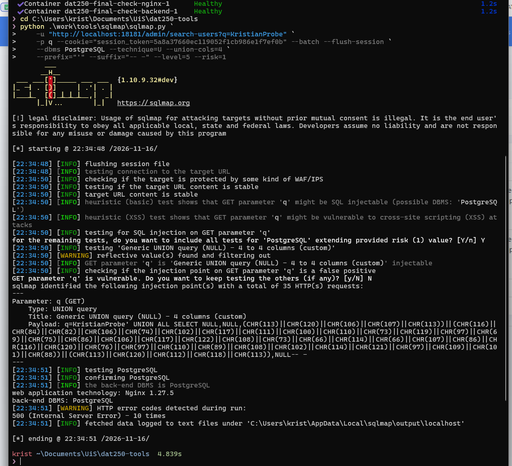
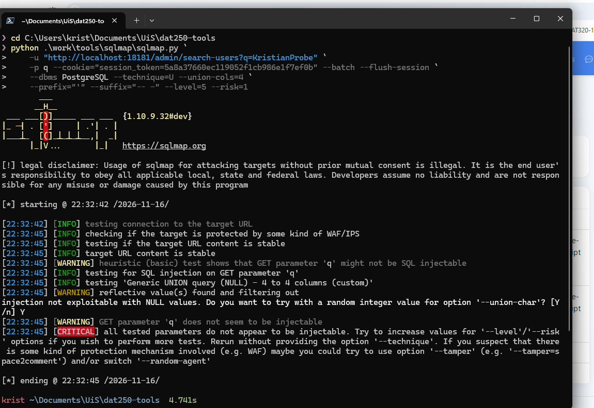
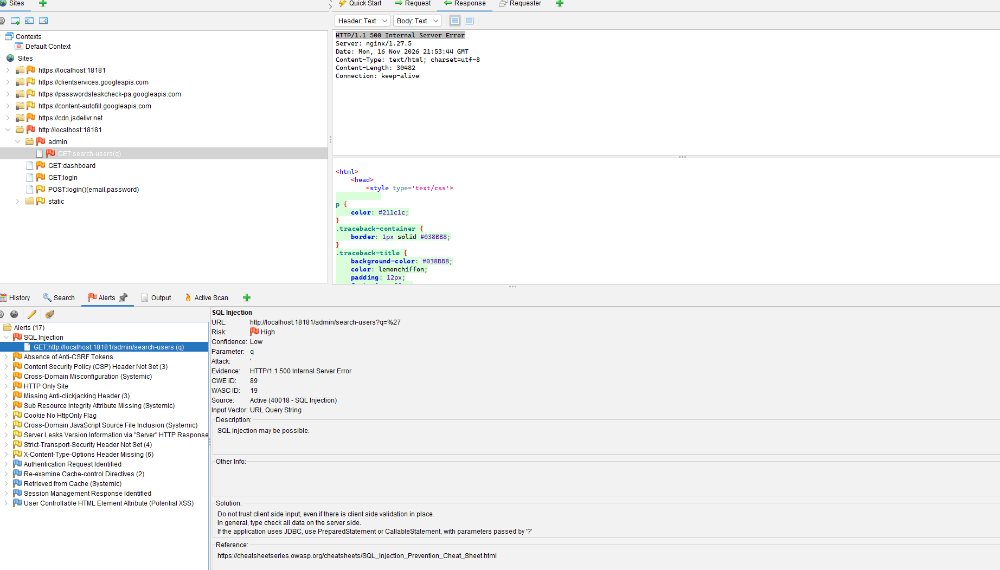
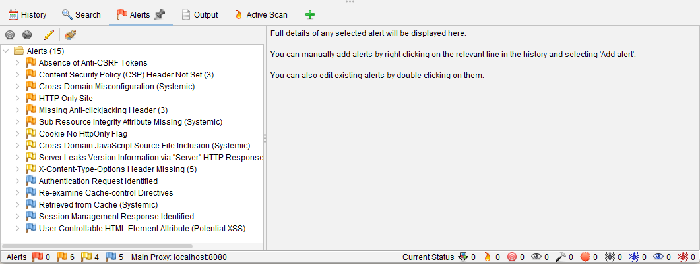
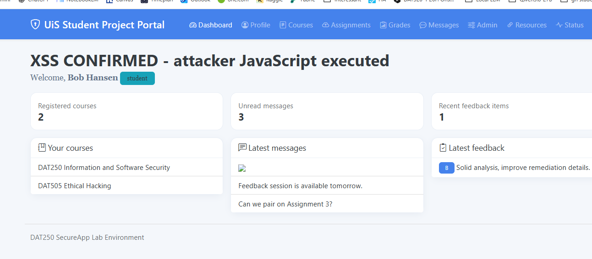
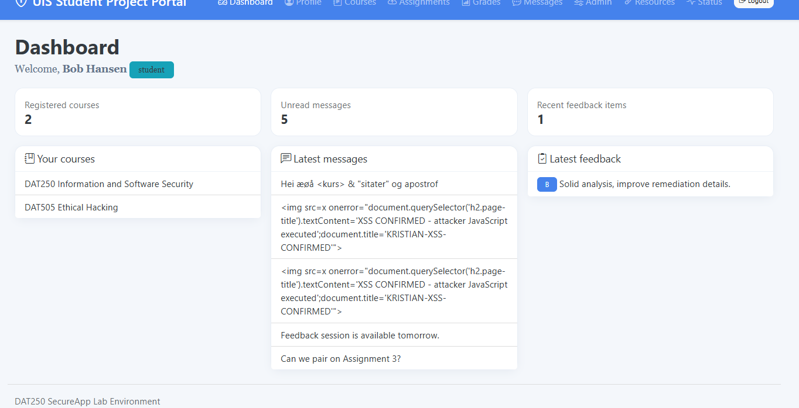

# DAT250 Assignment 2

Security Remediation and Verification

**Group members:** Kristian Bruvik Leine; Kyrre Elias Bjørkli

**Student IDs:** 290625 / 283466

**Repository:** https://github.com/kissa01/dat250-assignment2

**Date:** 16 November 2026

**Scope:** F01, F02, F04, F05 and F07

## Contents

1. Introduction
2. Vulnerability Summary
3. Root Cause Analysis
4. Security Remediation
5. Verification and Testing
6. Lessons Learned

## 1. Introduction

DAT250 SecureApp is a student portal made to be vulnerable on purpose. It uses FastAPI, Jinja templates and PostgreSQL. In Assignment 1 we found and exploited some of it's weaknesses. In Assignment 2 we fix five of them. We demonstrate that the original attacks no longer work and that normal use still works.

This report covers five findings from Assignment 1: F01 login account enumeration, F02 role escalation, F04 unauthorized grade read and write, F05 SQL injection in admin search and F07 stored XSS in messages. They fall in three categories: authentication, access control and input handling. Kyrre fixed F01 and F05. Kristian fixed F02, F04 and F07. Both parts use the same access policy (section 2.1).

### 1.1 Environment

| Item | Description |
| --- | --- |
| Vulnerable baseline | Original application |
| Fixed application | Application with our fixes implemented. |
| Lab | Local Docker stack from `docker compose up`, app at `http://127.0.0.1:18181`, MailHog at `http://127.0.0.1:8025` |
| Test identities | Seeded Alice (student, id 4), Bob (student, id 5), admin, teacher and TA |

## 2. Vulnerability Summary

| ID | Vulnerability | Category | Affected component | Impact |
| --- | --- | --- | --- | --- |
| F01 | Login account enumeration | Authentication | `POST /login`, `POST /reset-password` | Different messages expose email addresses with accounts |
| F02 | Self-service role escalation | Access control; business logic | `POST /profile/update`; alternate path `POST /admin/users/{id}/role` | Any student can make an account admin |
| F04 | Unauthorized grade read and modification | Access control; data exposure | `GET /grades/{id}`, `GET /admin/grades`, `POST /admin/grades/{id}/update` | A student can read and change another student's grade and feedback |
| F05 | SQL injection in admin search | Input handling (SQL injection) | `GET /admin/search-users` | A logged-in student can alter the query and inject fake rows |
| F07 | Stored XSS in internal messages | Input handling (XSS) | Message content in the dashboard, inbox and message detail views | The sender's JavaScript runs in the recipient's logged-in browser |

### 2.1 Intended access policy

F02 and F04 need a rule for who may do what. The assignment does not give one, so we chose the rules below. The original `/admin` page already lets in admin, teacher and TA, and the seed data has a TA who grades. The database has no link between staff and courses, so the rules are not per course.

| Action | Allowed for |
| --- | --- |
| Edit own name, phone, address and bio | Every logged-in user; never changes the role |
| List or search users | Admin, teacher, TA |
| Change a user's role | Admin only |
| Read one grade | The student who owns it; admin, teacher, TA |
| List or update grades | Admin, teacher, TA |

Every check uses the role stored in the database for the logged-in user. A role sent in a form field or header is never trusted.

## 3. Root Cause Analysis

### F01 - Login account enumeration

`login` in `backend/app/routes/auth_routes.py` returned "No account found with that email." for an unknown address and "Invalid password for this account." for a known address. `reset_password_request` also did this: "No user found with that email." or "Reset email sent to ...". An attacker can try email addresses to find which accounts exist.

### F02 - Self-service role escalation

`update_profile` in `backend/app/routes/profile_routes.py` (lines 63-80) accepted a `role` form field and wrote it straight into `users.role`. The profile form sent the current role in a hidden input, but the client controls every field it sends. The route checked that the user was logged in, but not what the user is allowed to change.

The `update_role` route had the same flaw. It allowed the change if the `x-role` header said admin or teacher, or if the requested role was valid. The second condition was true for all normal requests, and any logged-in student could change another user's role.

### F04 - Unauthorized grade read and modification

`grade_detail` in `grade_routes.py` found a grade by ID and returned it without checking who owned it (an insecure direct object reference). In `admin_routes.py`, `admin_grades` only checked that the user was logged in, and `update_grade` read the permission from a `role` field in the request itself instead of the stored role. Alice could read grade 2 and change it by sending `role=teacher`.

### F05 - SQL injection in admin search

`search_users` in `backend/app/routes/admin_routes.py` put `q` directly into an SQL string with an f-string. A quote ends the search value and the rest of the input run as SQL. Our UNION payload added a fake admin row to the result. A normal apostrophe, as in `O'Brien`, also broke the query and returned 500. The route only checked for a login, so students could use it.

### F07 - Stored XSS in internal messages

Storing the message was not the problem, because the insert is parameterized. The problem was how it was shown: `dashboard.html`, `messages.html` and `message_detail.html` printed `content` with Jinja's `|safe` filter. That filter turns off escaping, so the browser read the stored text as HTML and ran the `onerror` handler of the attacker's `` tag.

### Common cause

F01 showed the result of an account lookup to anyone. F02 and F04 trusted data from the client for authorization. F05 treated search text as SQL, and F07 treated message text as HTML. The fixes are: generic errors, stored permissions, bound query values and escaped output.

## 4. Security Remediation

The fixes are small and only touch affected routes and templates. F01 uses generic error messages. F02 and F04 check permissions on the server. F05 binds query parameters and checks the staff role. F07 turns escaping back on. No feature was removed and no dependency was added. The diffs compare the vulnerable baseline `c089832` with the fixed code. Some unchanged lines are left out.

### F01 - Use the same response for unknown accounts and wrong passwords

| Item | Description |
| --- | --- |
| Vulnerability | Response-based account enumeration; authentication |
| Affected component | `auth_routes.login`, `auth_routes.reset_password_request` |
| Root cause | Public messages announced whether the account lookup succeeded |
| Security fix | One login error and one reset message, whether or not the account exists. The password check runs in both cases. |
| Verification | Compared full responses, checked that a failed login creates no session, tested valid login and the password reset |
| Result | Login and reset no longer reveal whether an account exists; normal login and reset work |

The login always calls `verify_password`. For an unknown account it checks against a dummy hash that is made once at startup. Even if that matched, no session is created, because the account must exist.

```diff
--- a/backend/app/routes/auth_routes.py (login)
+++ b/backend/app/routes/auth_routes.py (login)
+DUMMY_PASSWORD_HASH = hash_password("dummy-password")
 ...
-    if not user:
-        return templates.TemplateResponse(
-            "login.html", {"request": request, "error": "No account found with that email."}
-        )
-    if not verify_password(password, user["password_hash"]):
+    stored_hash = user["password_hash"] if user else DUMMY_PASSWORD_HASH
+    if not verify_password(password, stored_hash) or not user:
         return templates.TemplateResponse(
-            "login.html", {"request": request, "error": "Invalid password for this account."}
+            "login.html", {"request": request, "error": "Invalid email or password."}
         )
```

The reset route creates a token and sends an email only for a real account. It returns the same message in both cases. The response does not contain the address or the token.

```diff
--- a/backend/app/routes/auth_routes.py (reset_password_request)
+++ b/backend/app/routes/auth_routes.py (reset_password_request)
-    if not user:
-        return templates.TemplateResponse(
-            "reset_password.html",
-            {"request": request, "mode": "request", "message": "No user found with that email."},
-        )
-    token = str(int(time.time()))[-6:]
-    run_query(..., (user["id"], token), commit=True)
-    send_reset_email(email, token)
+    if user:
+        token = str(int(time.time()))[-6:]
+        run_query(..., (user["id"], token), commit=True)
+        send_reset_email(email, token)
     return templates.TemplateResponse(
         "reset_password.html",
-        {"request": request, "mode": "request", "message": f"Reset email sent to {email}."},
+        {"request": request, "mode": "request", "message": "If an account exists for that email, a reset email has been sent."},
     )
```

This fixes the message leak we showed. Response timing and the duplicate-email message at registration are not fixed (section 6.1).

### F02 - Restrict profile fields and authorize role changes

| Item | Description |
| --- | --- |
| Vulnerability | Self-service role escalation; access control, business logic |
| Affected component | `profile_routes.update_profile`, `profile.html`, `admin_routes.update_role`, `admin_routes.admin_users`, `admin_users.html` |
| Root cause | The role was taken from a form field or header instead of the stored role |
| Security fix | Profile updates no longer accept a role; role changes require the stored admin role |
| Verification | Replayed the original attack, tried forged roles and headers, read the stored role from the database, tested normal profile and admin changes |
| Result | Remediated: the student's role stays `student`; non-admins get 403; normal use works |

We removed `role` from the profile form and from the profile `UPDATE`. Sending `role=admin` no longer changes the stored role.

```diff
--- a/backend/app/routes/profile_routes.py
+++ b/backend/app/routes/profile_routes.py
     bio: str = Form(""),
-    role: str = Form("student"),
 ):
-        UPDATE users SET full_name=%s, phone=%s, address=%s, bio=%s, role=%s
+        UPDATE users SET full_name=%s, phone=%s, address=%s, bio=%s
         WHERE id=%s
-        (full_name, phone, address, bio, role, user["id"]),
+        (full_name, phone, address, bio, user["id"]),
```

The role route now checks the stored role of the logged-in user first. Then it checks that the requested role is valid. A missing user returns 404.

```diff
--- a/backend/app/routes/admin_routes.py (update_role)
+++ b/backend/app/routes/admin_routes.py (update_role)
-    if request.headers.get("x-role") in ["admin", "teacher"] or role in ["admin", "teacher", "ta", "student"]:
-        run_query("UPDATE users SET role=%s WHERE id=%s", (role, user_id), commit=True)
+    if user["role"] != "admin":
+        raise HTTPException(status_code=403)
+    if role not in ["admin", "teacher", "ta", "student"]:
+        raise HTTPException(status_code=400)
+
+    updated = run_query("UPDATE users SET role=%s WHERE id=%s RETURNING id",
+                        (role, user_id), fetchone=True, commit=True)
+    if not updated:
+        raise HTTPException(status_code=404)
```

`admin_users` now needs a staff role, and `admin_users.html` shows the role form only to admin. The check on the server is what enforces this.

### F04 - Check grade ownership and staff role

| Item | Description |
| --- | --- |
| Vulnerability | Unauthorized grade read and modification; access control, data exposure |
| Affected component | `grade_routes.grade_detail`, `admin_routes.admin_grades`, `admin_routes.update_grade`, `admin_grades.html` |
| Root cause | No ownership check on reads; writes authorized by a submitted `role` field |
| Security fix | Reads require ownership or a stored staff role; listing and updates require a stored staff role |
| Verification | Replayed the original read and write, read the grade from the database, tested owner and staff access, tested missing and invalid IDs |
| Result | Remediated: both attacks return 403 and Bob's grade is unchanged; owners and staff keep access |

The URL holds a grade ID, not a student ID. So the check compares the grade's `student_id` with the logged-in user.

```diff
--- a/backend/app/routes/grade_routes.py (grade_detail)
+++ b/backend/app/routes/grade_routes.py (grade_detail)
+    if not grade:
+        raise HTTPException(status_code=404)
+    if grade["student_id"] != user["id"] and user["role"] not in ["admin", "teacher", "ta"]:
+        raise HTTPException(status_code=403)
     return templates.TemplateResponse("grade_detail.html", ...)
```

The update route no longer takes a `role` field, and the input was removed from `admin_grades.html`. `admin_grades` got the same staff check.

```diff
--- a/backend/app/routes/admin_routes.py (update_grade)
+++ b/backend/app/routes/admin_routes.py (update_grade)
     feedback: str = Form(...),
-    role: str = Form("student"),
 ):
-    if role in ["admin", "teacher", "ta"]:
-        run_query(
-            "UPDATE grades SET grade_value=%s, feedback=%s, status='published' WHERE id=%s",
-            (grade_value, feedback, grade_id),
-            commit=True,
-        )
+    if user["role"] not in ["admin", "teacher", "ta"]:
+        raise HTTPException(status_code=403)
+
+    updated = run_query(
+        "UPDATE grades SET grade_value=%s, feedback=%s, status='published' WHERE id=%s RETURNING id",
+        (grade_value, feedback, grade_id),
+        fetchone=True,
+        commit=True,
+    )
+    if not updated:
+        raise HTTPException(status_code=404)
```

### F05 - Bind search values and require a stored staff role

| Item | Description |
| --- | --- |
| Vulnerability | SQL injection in admin search; input handling. |
| Affected component | `admin_routes.search_users` |
| Root cause | Search input was inserted into SQL syntax; any logged-in user could reach the route |
| Security fix | Both search values are bound as parameters; the route needs a stored admin, teacher or TA role |
| Verification | Replayed the UNION payload as student, admin, teacher and TA; tested normal, empty, apostrophe and no-match searches and invalid sessions; ran sqlmap and ZAP before and after |
| Result | Students get 403; staff searches treat the payload as text and return no fake row; normal searches work |

The route uses the same check as `/admin/users` and `/admin/grades`. Users who are not logged in are sent to `/login`. Logged-in users without a staff role get 403.

```diff
--- a/backend/app/routes/admin_routes.py (search_users)
+++ b/backend/app/routes/admin_routes.py (search_users)
-    sql = f"SELECT id, email, full_name, role FROM users WHERE email ILIKE '%{q}%' OR full_name ILIKE '%{q}%'"
-    conn = get_conn()
-    ...
-            cur.execute(sql)
+    if user["role"] not in ["admin", "teacher", "ta"]:
+        raise HTTPException(status_code=403)
+
+    pattern = f"%{q}%"
+    users = run_query(
+        "SELECT id, email, full_name, role FROM users "
+        "WHERE email ILIKE %s OR full_name ILIKE %s ORDER BY id",
+        (pattern, pattern),
+        fetchall=True,
+    )
```

The query uses `%s` parameters, so the search text cannot change its SQL structure. `ILIKE` keeps the existing case-insensitive matching.

### F07 - Restore output escaping for messages

| Item | Description |
| --- | --- |
| Vulnerability | Stored cross-site scripting in internal messages; input handling |
| Affected component | Message content in `dashboard.html`, `messages.html` and `message_detail.html` |
| Root cause | `\|safe` disabled Jinja autoescaping for user-controlled content |
| Security fix | Removed `\|safe` from all three views so autoescaping applies. |
| Verification | Replayed the original payload in a browser for an old and a new message and tested normal text with special characters |
| Result | Remediated: payloads display as text in all three views and no script runs |

Autoescaping is on in the app's `Jinja2Templates` environment. We removed `|safe` in all three places:

```diff
--- a/backend/app/templates/dashboard.html
-        <li class="list-group-item">{{ m.content|safe }}</li>...
+        <li class="list-group-item">{{ m.content }}</li>...
--- a/backend/app/templates/messages.html
-    <div><strong>{{ m.sender_name }}</strong>: {{ m.content|safe }}</div>
+    <div><strong>{{ m.sender_name }}</strong>: {{ m.content }}</div>
--- a/backend/app/templates/message_detail.html
-  <p class="mb-0">{{ message.content|safe }}</p>
+  <p class="mb-0">{{ message.content }}</p>
```

Messages are plain text, so escaping works without a sanitizer library. It also fixes messages that were stored before the fix.

## 5. Verification and Testing

### 5.1 Method and setup

For each finding we ran the Assignment 1 attack against the vulnerable code and against our fixed code. We also tested normal use and invalid or unauthorized requests. We used one session per user and a browser for F07. After each write we read the stored value from database. A status code alone does not show if anything changed.

Start the fixed app and open a database shell:

```powershell
docker compose up --build -d --wait
docker compose exec -T db psql -U dat250 -d dat250 -Atc "SELECT id, role FROM users"
```

For the "before" results we ran the original source in the same containers, by mounting its `backend/app` over the fixed one. The database was kept between the two runs, so F07's message 4 was stored by the vulnerable version and read by the fixed one. Changes made by the attacks (Alice's role, Bob's grade) were reset with `psql`, not through the vulnerable routes. The commands below assume a fresh Alice session:

```powershell
$base = 'http://127.0.0.1:18181'
curl.exe -sS -c alice.cookie -o NUL -X POST `
  -d "email=alice%40student.uis.no&password=Alice123" "$base/login"
```

### 5.2 F01 - Account enumeration

**Original attack.** Send an unknown email and a known email with a wrong password to the login page, then do the same on the reset page. No login is needed.

```powershell
foreach ($email in 'nobody@example.test', 'alice@student.uis.no') {
  curl.exe -sS -i --data-urlencode "email=$email" `
    --data-urlencode "password=wrong" "$base/login"
  curl.exe -sS -i --data-urlencode "email=$email" "$base/reset-password"
}
```

| Check | Before fix | After fix |
| --- | --- | --- |
| Login, unknown email | 200, "No account found with that email." | 200, "Invalid email or password." |
| Login, known email, wrong password | 200, "Invalid password for this account." | 200, "Invalid email or password." |
| The two login responses | Different | Identical |
| Reset, unknown email | 200, "No user found with that email." | 200, "If an account exists for that email, a reset email has been sent." |
| Reset, known email | 200, "Reset email sent to alice@student.uis.no." | 200, the same message |
| Session cookie after failed login | None | None |

**Invalid requests.** An unknown reset address creates no reset token; a known address creates one.

**Legitimate use.** A valid login for Bob returns 302 and opens the dashboard. A reset request for Bob sends an email with his reset link to MailHog. The link opens the form (200) and changing the password returns 302. The old password is then rejected (200, login page) and the new one works (302, session cookie set). Bob's password was restored afterwards.

### 5.3 F02 - Role escalation

**Original attack.** Alice sends her normal profile fields plus `role=admin`. We also tried `POST /admin/users/5/role` with a fake `x-role: admin` header.

```powershell
curl.exe -sS -i -b alice.cookie -X POST `
  --data-urlencode "full_name=Alice Nilsen" `
  --data-urlencode "phone=+47 40001004" `
  --data-urlencode "address=Stavanger" `
  --data-urlencode "bio=Interested in web security." `
  --data-urlencode "role=admin" "$base/profile/update"
curl.exe -sS -i -b alice.cookie -X POST -H "x-role: admin" `
  --data-urlencode "role=admin" "$base/admin/users/5/role"
```

| Check | Before fix | After fix |
| --- | --- | --- |
| Profile update with `role=admin` | 302; Alice's stored role `admin` | 302; stored role `student` |
| Student changes Bob's role, forged header | 302; Bob's stored role `admin` | 403; Bob's role `student` |

**Invalid requests.** After the fix, teacher and TA also get 403 from the role route, even with the fake header. As admin, an unknown role returns 400 and a missing user returns 404, and nothing changes. Requests without a valid session are sent to `/login`.

**Legitimate use.** Profile updates by Alice, the teacher and the admin return 302 and save all four values. Each role stays the same. Admin can change Bob's role to `teacher` (302, stored `teacher`, restored afterwards). Admin, teacher and TA can list users (200).

### 5.4 F04 - Grade read and write

**Original attack.** Alice reads Bob's grade 2, then tries to change it with `role=teacher` in the form.

```powershell
curl.exe -sS -i -b alice.cookie "$base/grades/2"
curl.exe -sS -i -b alice.cookie -X POST `
  --data-urlencode "grade_value=PWNED" `
  --data-urlencode "feedback=Unauthorized local verification" `
  --data-urlencode "role=teacher" "$base/admin/grades/2/update"
```

| Check | Before fix | After fix |
| --- | --- | --- |
| Alice reads Bob's grade | 200 | 403 |
| Alice's forged update | 302 | 403 |
| Bob's grade in the database | `B` changed to `PWNED`, attacker feedback stored | Still `B`, feedback unchanged |

**Invalid requests.** After the fix, Alice gets 403 from `/admin/grades` and from an update with `role=admin` in the form and `x-role: admin` in the header. A missing grade returns 404 (read and update) and a non-numeric ID returns 422. Requests without a valid session are sent to `/login`.

**Legitimate use.** Alice and Bob can read their own grades (200). Admin, teacher and TA can open the grade list and Bob's grade (200). They can update it without sending a role field (302, new grade and feedback saved). The grade was restored afterwards.

### 5.5 F05 - Admin search SQL injection

**Original attack.** Alice searches with the Assignment 1 UNION payload. We also run it as admin, teacher and TA. 

```powershell
$query = "' UNION SELECT 999,'hahaha@pwned.com','Sjef','admin' -- "
curl.exe -sS -i -b alice.cookie --get `
  --data-urlencode "q=$query" "$base/admin/search-users"
curl.exe -sS -c admin.cookie -o NUL -X POST `
  -d "email=admin%40dat250.local&password=Admin123" "$base/login"
curl.exe -sS -i -b admin.cookie --get `
  --data-urlencode "q=$query" "$base/admin/search-users"
```

| Check | Before fix | After fix |
| --- | --- | --- |
| Student, UNION payload | 200, fake row 999 "Sjef" | 403 |
| Admin, UNION payload | 200, fake row 999 "Sjef" | 200, "No users found.", no fake row |
| Teacher and TA, UNION payload | Not run | 200, "No users found.", no fake row |
| Admin, `O'Brien` | 500 | 200 |
| Admin, `alice` | 200, Alice's row | 200, Alice's row |
| Admin, empty query | 200, users listed | 200, users listed |

**Automated confirmation.** As in Assignment 1, we ran sqlmap against `q`. Both runs used the same admin session, which can reach the route before and after the fix.

```powershell
python .\work\tools\sqlmap\sqlmap.py `
    -u "http://localhost:18181/admin/search-users?q=KristianProbe" `
    -p q --cookie="session_token=<admin session>" --batch --flush-session `
    --dbms PostgreSQL --technique=U --union-cols=4 `
    --prefix="'" --suffix="-- -" --level=5 --risk=1
```

Before the fix, sqlmap finds a four-column UNION injection and the PostgreSQL back end (Figure 3). After the fix, it says `q` does not seem to be injectable (Figure 4).





In Assignment 1, ZAP gave a high-risk, low-confidence SQL Injection alert on `q`. It was based on the HTTP 500 caused by a single quote. We ran an active scan again (ZAP 2.17.0, Pen Test policy) on `GET /admin/search-users?q=test`. Before the fix ZAP gave the same alert: parameter `q`, attack `'`, evidence `HTTP/1.1 500 Internal Server Error` (Figure 5). That scan used Alice's session. After the fix ZAP gave no SQL Injection alert (Figure 6). That scan used an admin session, because students now get 403.





**Invalid requests.** After the fix, a student request with `x-role: admin` still gets 403, and requests without a valid session are sent to `/login`.

**Legitimate use.** Searches by admin, teacher and TA return 200. `ALICE` finds Alice and `no-such-user` returns "No users found.". With Bob renamed to `Bob O'Brien` in the lab database, searching `O'Brien` returns his row. His name was restored afterwards.

### 5.6 F07 - Stored XSS

**Original attack.** Alice sends Bob the Assignment 1 payload. Bob logs in with a browser and opens the dashboard, the inbox and the message page.

```powershell
$payload = ''
curl.exe -sS -b alice.cookie -X POST `
  --data-urlencode "recipient_id=5" --data-urlencode "content=$payload" `
  "$base/messages"
```

Message 4 was stored by the vulnerable version. It was kept unchanged (ID, content and time) when we switched to the fixed code. Message 5 is the same payload, sent after the fix.

| View | Before fix (message 4) | After fix (messages 4 and 5) |
| --- | --- | --- |
| Dashboard `/dashboard` | Script ran: heading and tab title replaced | Both payloads shown as text, heading and title unchanged |
| Inbox `/messages` | Script ran | Both payloads shown as text, title `DAT250 SecureApp` |
| Detail `/messages/4`, `/messages/5` | Script ran | Payload shown as text, title `DAT250 SecureApp` |





**Legitimate use.** A normal message, `Hei æøå <kurs> & "sitater" og apostrof` (message 6), shows exactly as written in the dashboard and inbox.

### 5.7 Automated tests

During development we also ran 24 automated tests for the five findings. They failed on the vulnerable code and passed on the final code. The tests are not in this repository, so the results in this section come from the manual run above.

## 6. Lessons Learned

- The same mistake, trusting the client, was in two places: a hidden `role` field in the profile form and an `x-role` header on the role route. Removing the field alone would have left the second route open.
- The grade URL holds a grade ID, not a student ID. The check has to compare the grade's `student_id` with the logged-in user.
- A status code did not show whether a fix worked. Both F02 requests returned 302 before and after the fix. Only the stored role showed the difference.
- For F05, blocking Alice would have hidden an injection that was still there. We ran the payload as admin, teacher and TA to test the SQL itself. A 500 is not a rejection either: `O'Brien` returned 500 before the fix.
- ZAP flagged `q` only because of the HTTP 500, as in Assignment 1. The manual UNION payload and sqlmap showed the real injection. After the fix, neither ZAP nor sqlmap found anything.
- The same unsafe `|safe` was in three templates. We removed it in all three and checked old and new messages in a browser.
- For F01, matching the messages closed the difference we found. We did not measure timing, and registration still shows duplicate emails.

### 6.1 Limitations and remaining work

The five fixes cover the attacks from Assignment 1. The application as a whole is not secure. Other vulnerabilities are outside this report. Known open issues:

- F01 only covers the login and reset messages. Registration still reports duplicate email addresses, and timing and mail failures are not checked.
- Passwords still use the lab's SHA-256 helper. Reset tokens are predictable and never expire.
- F03 (SSRF) and F06 (cookie flags) are not fixed.
- Grade feedback is still shown with `|safe` in several templates. After F04 only staff can write it.
- The message page does not check that the viewer is the sender or the recipient.
- No Content Security Policy is set.
